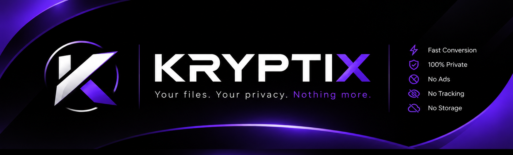
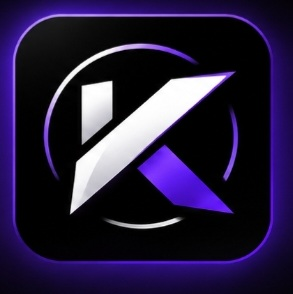

<div align="center">



<br><br>



# KRYPTIX

**A private file converter that runs entirely in your browser.**
No uploads. No accounts. No ads. No tracking. No storage.

<br>

[](https://justincheriyantiju-glitch.github.io/kryptix-convert/)
[](#-how-it-works)
[](#-tech-stack)

</div>

---

## ✨ Why KRYPTIX?

Most online converters upload your files to someone else's server. KRYPTIX doesn't. Every conversion happens **locally on your device**, using JavaScript in your browser, so your documents, photos and data stay yours.

| | |
|---|---|
| ⚡ **Fast conversion** | Drop a file, convert, download. No queues or waiting on a server. |
| 🛡️ **100% private** | Files are processed on your device and never uploaded. |
| 🚫 **No ads** | A clean interface with nothing in your way. |
| 👁️ **No tracking** | No analytics, cookies or accounts. |
| ☁️ **No storage** | Nothing is saved anywhere. Close the tab and it's gone. |
| 🍎 **Beautifully designed** | A minimal, Apple-inspired purple and black interface. |

---

## 🔄 Supported Conversions

### 📄 Documents
| Conversion | Notes |
|---|---|
| Text → PDF | Multi-page, auto line wrapping |
| Images → PDF | One image per page, auto orientation |
| PDF → Text | Extracts text from every page |
| PDF → PNG / JPG | Every page rendered as an image |
| Word (.docx) → HTML / Text / Markdown | Powered by Mammoth |
| Text → Word (.docx) | Plain paragraphs |
| Text ⇄ RTF | RTF → Text is basic extraction |
| Markdown → HTML | |
| HTML → Text / Markdown | |
| OpenDocument (.odt) → Text | |
| PowerPoint (.pptx) → Text | Text from every slide |
| eBook (.epub) → Text | |

### 🖼️ Images
| Conversion | Notes |
|---|---|
| Image → PNG / JPG / WebP | Batch supported, quality slider. Accepts PNG, JPG, WebP, GIF, BMP and SVG |
| HEIC → JPG / PNG | iPhone photos |

### 📊 Data & Spreadsheets
| Conversion | Notes |
|---|---|
| CSV ⇄ JSON | |
| JSON ⇄ YAML | |
| JSON ⇄ XML | |
| CSV / JSON → Excel (.xlsx) | |
| Excel → CSV / JSON | First sheet |
| Excel ⇄ ODS | |
| XLS ⇄ XLSX | |

### 🎵 Audio
| Conversion | Notes |
|---|---|
| Audio / Video → WAV | Also extracts a video's audio track |
| Audio → MP3 | 128 kbps |

### 🗜️ Archives
| Conversion | Notes |
|---|---|
| Files → ZIP | Multiple files |
| ZIP → Files | Extracts every file |
| File ⇄ GZ | gzip compress and decompress |

### 🧊 3D
| Conversion | Notes |
|---|---|
| OBJ ⇄ STL | ASCII STL, ready for 3D printing |

### 🔐 Encoding
| Conversion | Notes |
|---|---|
| Text ⇄ Base64 | |
| File → Base64 | |
| URL Encode / Decode | |

---

## 🔒 How It Works

KRYPTIX has **no backend**. It's a static site, so there's no server to receive your files.

1. You choose a file or type some text.
2. Your browser converts it using JavaScript.
3. The result is handed straight back to you as a download.

Your files are never sent over the network. Conversion libraries (such as jsPDF, PDF.js, SheetJS and JSZip) are fetched from the [cdnjs](https://cdnjs.com) CDN the first time a tool needs them, and only the tool you use loads its library. For a fully offline setup, download those scripts and host them next to `index.html`.

---

## 🚀 Getting Started

### Use it online
Open the [live demo](https://justincheriyantiju-glitch.github.io/kryptix-convert/).

### Run it locally
```bash
git clone https://github.com/justincheriyantiju-glitch/kryptix-convert.git
cd kryptix
```
Then open `index.html` in your browser. No build step and no dependencies to install.

### Deploy your own copy with GitHub Pages
1. Fork this repository.
2. Go to **Settings → Pages**.
3. Under **Source**, choose **Deploy from a branch**, select `main` and `/ (root)`, then save.
4. Your site goes live at `https://justincheriyantiju-glitch.github.io/kryptix-convert/`.

---

## 🧱 Tech Stack

- **HTML, CSS and vanilla JavaScript** in a single `index.html`
- [jsPDF](https://github.com/parallax/jsPDF) for PDF creation
- [PDF.js](https://github.com/mozilla/pdf.js) for PDF reading and rendering
- [Mammoth](https://github.com/mwilliamson/mammoth.js) for Word documents
- [SheetJS](https://github.com/SheetJS/sheetjs) for spreadsheets
- [JSZip](https://github.com/Stuk/jszip) for archives, DOCX, ODT, PPTX and EPUB
- [Marked](https://github.com/markedjs/marked) and [Turndown](https://github.com/mixmark-io/turndown) for Markdown and HTML
- [js-yaml](https://github.com/nodeca/js-yaml) for YAML
- [lamejs](https://github.com/zhuker/lamejs) for MP3 encoding
- [heic2any](https://github.com/alexcorvi/heic2any) for HEIC photos

---

## 📁 Project Structure

```
kryptix-convert/
├── index.html      # the entire app
├── assets/
│   ├── banner.png
│   └── logo.jpg
├── README.md
```

---

## ⚠️ Limitations

Because everything runs in the browser, a few conversions aren't possible without a server or very large libraries:

- Video-to-video conversion, and FLAC, AIFF, AAC or Opus encoding
- High-fidelity PDF ⇄ Word, and PPTX → PDF
- CAD formats such as DWG, DXF and STEP, plus RAW camera files and TIFF
- Creating RAR, 7z or tar archives

Very large files are limited by your device's memory.

---

## 🗺️ Roadmap

- [ ] Video conversion and FLAC support via ffmpeg.wasm
- [ ] Self-hosted libraries for fully offline use
- [ ] tar extraction
- [ ] PDF merge and split
- [ ] Image resizing and compression options
- [ ] Installable PWA

Have an idea? [Open an issue](https://github.com/justincheriyantiju-glitch/kryptix-convert/issues).

---

## 🤝 Contributing

Contributions are welcome.

1. Fork the repo
2. Create your branch: `git checkout -b feature/new-converter`
3. Commit your changes: `git commit -m "Add new converter"`
4. Push the branch: `git push origin feature/new-converter`
5. Open a pull request

New converters are easy to add: each one is a single entry in the `C` array in `index.html`.

---


<div align="center">

**KRYPTIX** — Your files. Your privacy. <span style="color:#7c4dff">Nothing more.</span>

⭐ If you find it useful, consider starring the repo.

</div>
